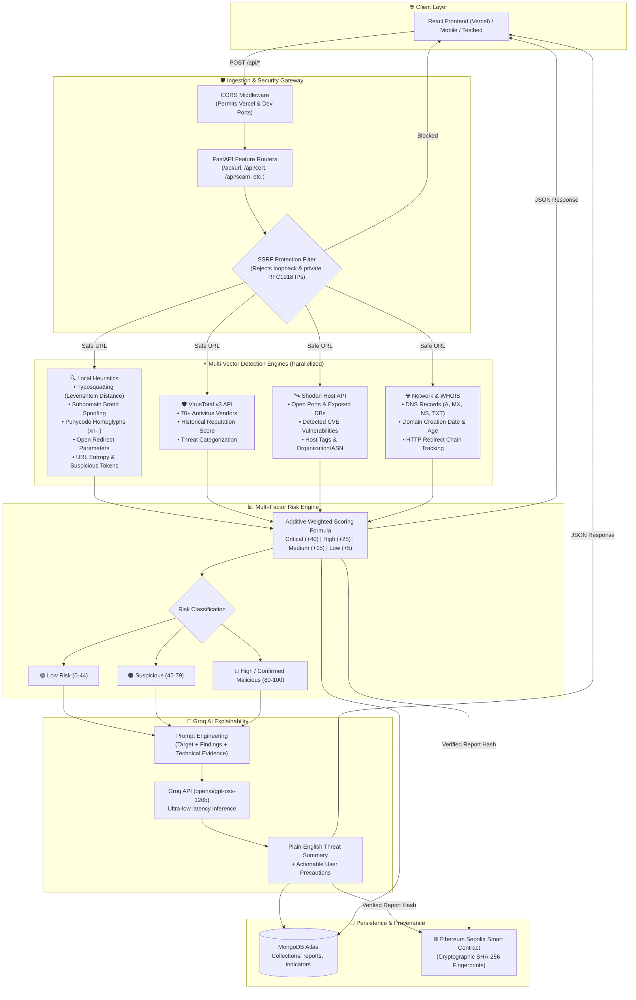

# 🏗️ Backend System Architecture — Cyber Chakravyuh

> **AI-Powered Web Threat Detection & Digital Trust Intelligence**  
> *A high-level guide to understanding how the Cyber Chakravyuh backend investigates, scores, and explains digital threats.*

---

## 1. Executive Summary

**Cyber Chakravyuh** is an intelligent web security engine built for a 48-hour hackathon. The backend is designed with a **Vertical-Slice (Feature-Based) Architecture** in **FastAPI (Python)**, backed by **MongoDB Atlas**, **Groq AI**, **VirusTotal**, and **Shodan**.

Instead of acting as a simple "black box" that labels a website as safe or dangerous, Cyber Chakravyuh acts as an **automated cyber forensics analyst**:
1. It validates and sanitizes input to prevent SSRF.
2. It decomposes URLs into their structural and linguistic components.
3. It queries multiple live global threat intelligence networks in parallel.
4. It computes an evidence-based multi-factor risk score (0–100).
5. It passes all gathered technical evidence to a large language model on Groq to generate a plain-English explanation with actionable precautions.

---

## 2. High-Level Architecture Diagram



---

## 3. The 6 Vertical Feature Modules

To allow multiple developers to work simultaneously without code collisions or merge conflicts, the backend is organized into **self-contained feature folders** under `backend/app/features/`. Each folder encapsulates its own routes, business logic, and data schemas:

| Module | Directory | Responsibility | Primary Technologies |
|---|---|---|---|
| **1. URL & Phishing Scanner** | `features/url_scanner/` | URL normalization, typosquatting, homoglyphs, open redirects, threat feeds | `tldextract`, `python-whois`, `dnspython`, VirusTotal, Shodan |
| **2. TLS Trust & Cert Analyzer** | `features/cert_analyzer/` | HTTPS handshake, certificate chain validation, CT logs, distrusted CAs | Python `ssl`, `cryptography`, `crt.sh` |
| **3. AI Scam Detector** | `features/scam_detector/` | SMS/Email social engineering detection, urgency patterns, credential harvesting | Groq API (`openai/gpt-oss-120b`), Regex |
| **4. Website Security Auditor** | `features/security_auditor/` | Passive security headers check (CSP, HSTS, X-Frame-Options), TLS ciphers | `httpx`, Shodan Host API |
| **5. Threat Correlation** | `features/threat_intel/` | Correlates recurring campaigns sharing underlying IPs, domains, or infrastructure | MongoDB aggregation queries |
| **6. Web3 Threat Registry** | `features/web3_registry/` | Hashes verified reports on-chain for tamper-proof provenance | Solidity, Web3.py, Sepolia Testnet |

---

## 4. How the Multi-Layer Detection Works

When a URL (e.g., `http://paypal.account-verify.com.evil.xyz` or `http://malware.wicar.org/...`) is submitted, the engine evaluates it through **four concentric defense layers**:

```
[Layer 1: SSRF Guard] 
   └── Rejects private, local, and reserved network addresses (127.0.0.1, 10.x, 192.168.x).

[Layer 2: Local Heuristics (Instant & Deterministic)]
   ├── Brand in Subdomain: Detects 'paypal' in subdomain when root domain is 'evil.xyz' (+40 pts)
   ├── Typosquatting: Levenshtein edit distance 1-2 from 25+ target brands (+25 pts)
   ├── Open Redirects: Inspects query parameters (?redirect_to=http://evil.com) (+25 pts)
   ├── Suspicious Keywords: Detects 'verify', 'account', 'login', 'kyc' in subdomains (+25 pts)
   ├── Cross-Domain Redirects: Detects initial domain jumping to unrelated destination (+25 pts)
   ├── Punycode Homoglyphs: Detects internationalized IDN deception (xn--) (+15 pts)
   └── Subdomain Nesting & Entropy: Detects multi-level nesting (>=3) and high randomness (+15 pts)

[Layer 3: External Intelligence Feeds (Concurrently Gathered)]
   ├── VirusTotal: Cross-references 70+ antivirus and web reputation vendors (+80 pts if malicious)
   ├── Shodan: Discovers open ports, exposed databases (MongoDB/Redis/MySQL), and known CVEs (+15-45 pts)
   └── WHOIS & DNS: Penalizes newly registered disposable domains (<=7 days: +30 pts, <=30 days: +15 pts)

[Layer 4: AI Threat Synthesis (Groq Llama-3 / GPT-OSS)]
   └── Takes the raw technical findings and writes a 2-sentence plain-English explanation + 3 precautions.
```

---

## 5. Scoring & Risk Classification

The engine uses an **additive scoring model** capped at 100 points:

$$\text{Final Risk Score} = \min(100, \text{HeuristicFindings} + \text{ThreatFeeds} + \text{DomainAge} + \text{ShodanExposure})$$

### Risk Tiers
- **🔴 High Risk / Confirmed Malicious ($80 - 100$)**: Multiple critical indicators or confirmed malicious by authoritative threat intelligence feeds.
- **🟠 Suspicious ($45 - 79$)**: One or more high-severity indicators (e.g. brand impersonation or open redirects) requiring caution.
- **🟢 Low Risk ($0 - 44$)**: Clean domain structure, established domain age, with no detected malicious flags.

---

## 6. Security & Privacy Safeguards

1. **Passive Inspection Only**: The system strictly limits its actions to passive inspection (DNS, SSL certificates, HTTP response headers, public threat feeds). It **never executes scripts**, downloads payloads, or performs intrusive attacks.
2. **SSRF Guard**: Resolves hostnames before sending HTTP requests and drops any destination in loopback, private RFC1918, or link-local address spaces.
3. **Off-Chain Privacy**: Sensitive user communications and raw inputs are never committed to the public blockchain. Only cryptographic hash commitments (`SHA-256`) are stored on-chain to verify report integrity.

---

## 7. Technology Stack Summary

| Component | Technology | Rationale |
|---|---|---|
| **Web Framework** | FastAPI (Python 3.10+) | High asynchronous throughput, native OpenAPI docs, rich cybersecurity library support. |
| **AI Inference** | Groq API (`openai/gpt-oss-120b`) | Sub-second inference latency with deep reasoning for threat explainability. |
| **Threat Feeds** | VirusTotal v3 API | Industry-standard multi-vendor malware and phishing consensus. |
| **Infrastructure Intel** | Shodan Host API | Passive port discovery, exposed database detection, and CVE vulnerability mapping. |
| **Database** | MongoDB Atlas (Motor async) | Schema-free JSON document model matching dynamic threat reports and nested findings. |
| **Web3** | Solidity + Web3.py | Tamper-evident on-chain threat report registry on Ethereum Sepolia. |
