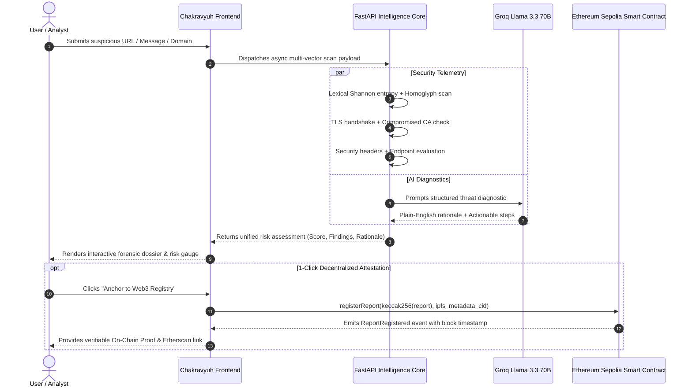

<div align="center">

# 🛡️ CYBER CHAKRAVYUH
### AI-Powered Web Threat Detection & Decentralized Digital Trust Intelligence

[](https://github.com)
[](LICENSE.md)
[](https://fastapi.tiangolo.com)
[](https://react.dev)
[](https://groq.com)
[](https://sepolia.etherscan.io)

<p align="center">
  <b>A unified defense ecosystem fusing deterministic cybersecurity heuristics, high-speed LLM explainability, and cryptographic blockchain attestation to eliminate phishing, scams, and digital identity fraud.</b>
</p>

[Live Demo](#-live-demo--preview) • [Key Innovations](#-key-innovations) • [Core Modules](#-the-six-pillar-architecture) • [Architecture](#-system-architecture) • [Quick Start](#-quick-start) • [Security & Privacy](#-zero-pii--cryptographic-integrity)

---

</div>

## 🌟 Executive Summary

Digital deception has outpaced traditional signature-based firewalls. Modern adversaries deploy short-lived throwaway domains, exploit Certificate Authority weaknesses (e.g., the recent **eMudhra TLS CA key-generation compromise**), obfuscate multi-hop cloaking redirects, and generate highly convincing, emotionally urgent phishing lures via generative AI.

**Cyber Chakravyuh** (*inspired by the ancient Indian multi-layered defensive labyrinth*) is an end-to-end trust intelligence platform. Rather than providing opaque binary ("Safe/Unsafe") verdicts, it operates as an **investigative forensic analyst**:
1. **Deconstructs Multi-Vector Ingress**: Dissects URLs, TLS handshakes, message text, and website headers simultaneously.
2. **Explainable AI Diagnostics**: Generates human-understandable, evidence-backed rationales via **Llama 3.3 70B on Groq**.
3. **Decentralized Provenance Anchor**: Binds tamper-evident cryptographic report digests to **Ethereum Sepolia**—guaranteeing verifiable audit trails without ever exposing sensitive PII on-chain.

---

## ⚡ Key Innovations (Why We Win)

| Feature | Conventional Threat Scanners | Cyber Chakravyuh |
| :--- | :--- | :--- |
| **Verdict Explainability** | Opaque numerical risk score (0-100) with no context. | **Plain-English forensic diagnostic** citing exact lexical indicators, header lapses, and lure psychology. |
| **Trust Infrastructure Analysis** | Basic green-padlock verification (easily abused by attackers). | **Deep TLS handshake inspection**, CRL/OCSP endpoints, SAN enumerations, and **compromised CA blacklist** (eMudhra, DigiNotar). |
| **Social Engineering Defense** | Simple keyword blacklist (`urgent`, `verify`). | **Cognitive manipulation scoring**, urgency vectors, sender impersonation mapping, and automated link extraction. |
| **Intelligence Sharing** | Centralized, siloed, vulnerable to deletion or tampering. | **Decentralized Web3 threat registry** with keccak256 cryptographic commitments & independent prover verification. |
| **Data Privacy** | Sensitive credentials & emails uploaded to remote servers. | **Zero-PII guarantee**: Evaluated in volatile memory, payload hashed client/server side, never stored on-chain. |

---

## 🏛️ The Six-Pillar Architecture

Cyber Chakravyuh maps 1:1 to the 6 mission-critical functional modules specified in the National Cybersecurity Problem Statement:

```
┌──────────────────────────────────────────────────────────────────────────────┐
│                            CYBER CHAKRAVYUH SUITE                            │
├──────────────────────┬──────────────────────┬────────────────────────────────┤
│      MODULE 1        │      MODULE 2        │           MODULE 3             │
│ Intelligent URL &    │ TLS Certificate &    │ AI-Powered Scam &              │
│ Phishing Analysis    │ Web Trust Analysis   │ Message Analysis               │
├──────────────────────┼──────────────────────┼────────────────────────────────┤
│      MODULE 4        │      MODULE 5        │           MODULE 6             │
│ Intelligent Threat   │ Website Security     │ Decentralized Threat           │
│ Correlation & Graph  │ Configuration Audit  │ Intelligence (Web3)            │
└──────────────────────┴──────────────────────┴────────────────────────────────┘
```

### 1. 🔍 Intelligent URL & Phishing Analysis
- **Lexical Entropy & Homoglyphs**: Calculates Shannon Entropy to uncover algorithmic randomness and detects Cyrillic/Greek spoofed homoglyphs (`pаypal.com` vs `paypal.com`).
- **Redirect Uncloaking**: Follows multi-hop HTTP 301/302/307 redirections to unmask cloaked destination URLs before sandboxes execute them.
- **Brand Mimicry Engine**: Cross-references domain tokens against 120+ targeted global and regional financial, banking, and government brands.

### 2. 🔒 TLS Certificate & Web Trust Analysis
- **Handshake Forensics**: Direct TLS 1.2/1.3 socket negotiation extracting cipher suites, key algorithms (RSA/ECDSA), Subject Alternative Names (SANs), and validity windows.
- **Distrusted CA Knowledge Base**: Built-in algorithmic detection for known compromised root and intermediate certificate authorities (including **eMudhra TLS CA** and **DigiNotar**).
- **Certificate Transparency (CT)**: Integrates with `crt.sh` to track historical issuance telemetry and detect rogue certificates.

### 3. 💬 AI-Powered Scam & Message Analysis
- **Manipulation Detection**: Detects synthetic urgency, coercive threats, fake lottery windfalls, and CEO impersonation schemes.
- **Automated Indicator Extraction**: Parses input excerpts to automatically surface phone numbers, crypto wallet destinations, and embedded ingress URLs.
- **Fast Groq Llama 3.3 Engine**: Sub-second generation of executive security summaries and customized mitigation actions for non-technical users.

### 4. 🕸️ Intelligent Threat Correlation
- **Interactive Relationship Graph**: Force-directed multi-entity visualizer connecting malicious domains, IP subnets, BGP Autonomous System Numbers (ASNs), and registrar clusters.
- **Campaign Tracking**: Tracks organized threat actor operations (e.g., *Operation PhantomHook*, *Hydra-CredHarvest*, *Specter-OAuth*).
- **Cross-Incident Telemetry**: Identifies shared nameservers and infrastructure overlap across seemingly unrelated phishing attacks.

### 5. 🛡️ Passive Website Security Assessment
- **HTTP Security Header Audit**: Validates existence and strictness of `Content-Security-Policy` (CSP), `Strict-Transport-Security` (HSTS), `X-Frame-Options`, `X-Content-Type-Options`, and `Referrer-Policy`.
- **Exposed Endpoint Detection**: Probes for dangerously exposed configuration artifacts (`.git`, `.env`, backup archives, unprotected API dashboards).
- **Cipher Suite Evaluation**: Audits deprecated ciphers (RC4, 3DES, CBC-mode) and validates forward secrecy (PFS).

### 6. ⛓️ Decentralized Threat Intelligence (Web3)
- **Zero-PII On-Chain Commitments**: Generates deterministic Keccak-256 cryptographic hashes of threat reports and registers them on **Ethereum Sepolia**.
- **Cryptographic Prover**: Allows independent security auditors to verify whether an investigation report is authentic, unmodified, and timestamped without requiring access to a centralized server.
- **Dispute & Revision Tracking**: Full on-chain lifecycle management enabling security researchers to endorse, contest, or update threat intelligence records.

---

## 🔄 End-to-End User Experience Flow



---

## 💻 Tech Stack & Infrastructure

```
Frontend               Backend & Intelligence            Web3 & Decentralization
─────────────          ──────────────────────            ───────────────────────
• React 19             • FastAPI (Python 3.11)           • Solidity 0.8.20
• TypeScript           • Uvicorn (ASGI)                  • ThreatRegistry.sol
• Vite 8               • Groq SDK (Llama 3.3 70B)        • Ethereum Sepolia Testnet
• Tailwind CSS v4      • Cryptography (X.509 ASN.1)      • Web3.py & Ethers.js
• Lucide React Icons   • HTTPX (Async HTTP Client)       • IPFS Content Addressing
• Canvas Graph API     • Pydantic v2 Models              • Keccak-256 Hashing
```

---

## 🔒 Zero-PII & Cryptographic Integrity

Cyber Chakravyuh adheres strictly to decentralized privacy standards:
> **"A blockchain record establishes the integrity and verifiable history of a security report, not the raw contents of the report itself."**

1. **No Sensitive Data On-Chain**: Passwords, email bodies, phone numbers, and identity tokens remain strictly local or off-chain.
2. **Deterministic Cryptographic Digest**: Only the SHA-256 / Keccak-256 fingerprint of the sanitized threat finding is submitted to the smart contract.
3. **Independent Integrity Verification**: Anyone with a copy of the security report can pass it into the **Report Verification Prover** to verify against Ethereum whether the report was tampered with or modified.

---

## 🚀 Quick Start Guide

### Prerequisites
- **Node.js** >= 18.0.0
- **Python** >= 3.10
- **npm** or **pnpm**
- *(Optional)* Free [Groq API Key](https://console.groq.com) for real-time AI reasoning.

---

### 1. Clone & Set Up Environment

```bash
git clone https://github.com/samvrit-hazra/cyber-chakravyuh.git
cd cyber-chakravyuh
```

Create `.env` inside `backend/`:
```bash
cp backend/.env.example backend/.env
```
Add your Groq API key (the system gracefully uses built-in heuristic AI explanations if omitted):
```env
GROQ_API_KEY=gsk_your_groq_api_key_here
GROQ_MODEL=llama-3.3-70b-versatile
```

---

### 2. Launch the Backend (FastAPI)

```bash
cd backend
python3 -m venv venv
source venv/bin/activate       # On Windows: venv\Scripts\activate
pip install -r requirements.txt
uvicorn app.main:app --reload --host 0.0.0.0 --port 8000
```
* Backend API: `http://localhost:8000`
* Interactive API Documentation (Swagger): `http://localhost:8000/docs`

---

### 3. Launch the Frontend (Vite + React)

In a **separate terminal window**:
```bash
cd frontend
npm install
npm run dev
```
* Frontend Application: `http://localhost:5173`

---

## 🚢 Deployment

Cyber Chakravyuh is pre-configured for automated cloud deployment via [`render.yaml`](render.yaml):

```
┌─────────────────────────────────┐
│        RENDER BLUEPRINT         │
├────────────────┬────────────────┤
│ Python Web     │ Static Web     │
│ Service        │ Service        │
│ (FastAPI API)  │ (Vite Client)  │
└────────────────┴────────────────┘
```

1. Push your code to your GitHub repository.
2. Navigate to [dashboard.render.com/blueprints](https://dashboard.render.com/blueprints).
3. Connect your repository and select `render.yaml`.
4. Enter your `GROQ_API_KEY` when prompted and click **Apply**. Both frontend and backend will build and deploy automatically!

---

## 🧪 Testing & Verification

Run the automated test suite across all security modules:

```bash
# Run backend test suite
cd backend
source venv/bin/activate
python -m pytest tests/

# Run frontend build verification
cd ../frontend
npm run build
```

---

<div align="center">
  <sub>Built to defend users and restore trust to the open web. 🛡️</sub>
</div>
